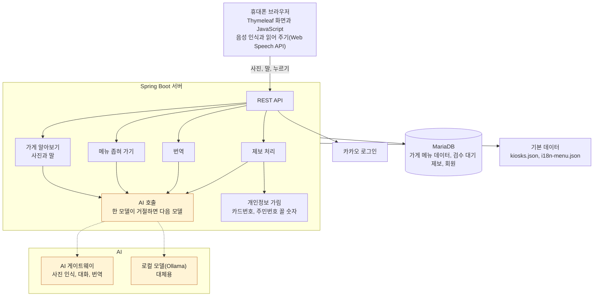
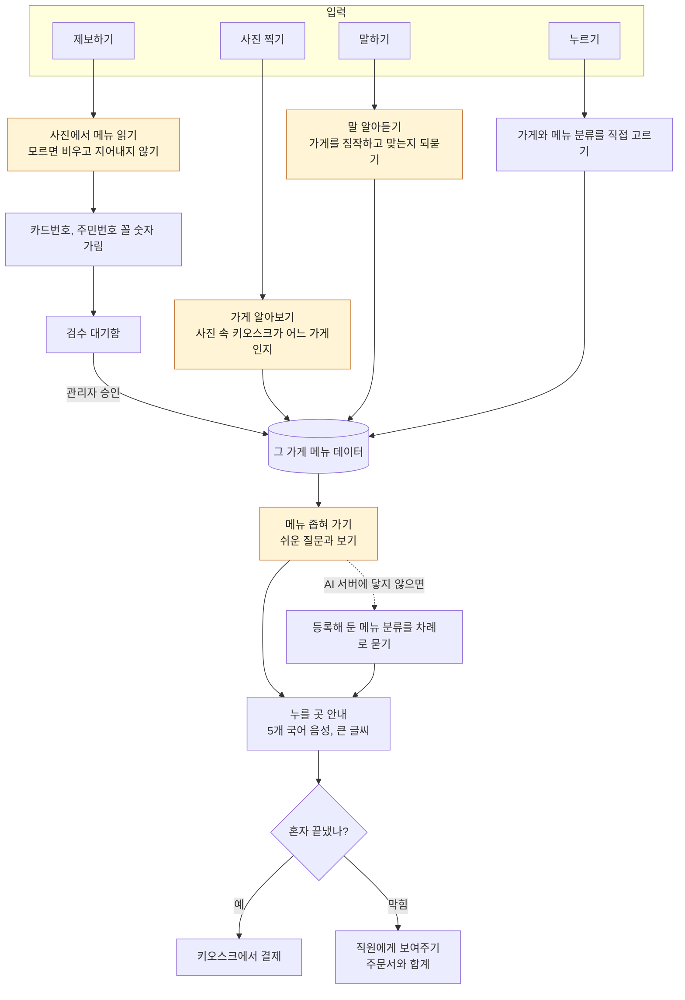
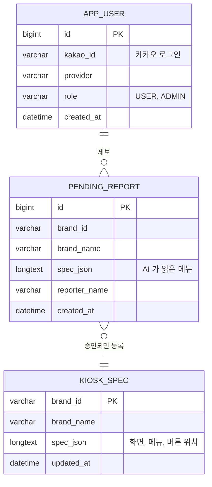

<div align="center">


# 오몽 OMONG

**키오스크 주문 도우미**

키오스크를 찍으면 그 가게 메뉴에서 무엇을 누를지 5개 국어 음성과 큰 글씨로 알려 주고, 막히면 「직원에게 보여주기」 로 주문서를 띄웁니다.

[](#기술-스택)
[](#기술-스택)
[](#기술-스택)
[](#기술-스택)
[](#기술-스택)
[](#기술-스택)
[](#기술-스택)

[서비스 열기](https://omong.r-e.kr) &nbsp;|&nbsp; [시연 영상](https://ynkite.github.io/portfolio/assets/omong-intro.mp4) &nbsp;|&nbsp; [보도](https://www.newsnjeju.com/news/articleView.html?idxno=291702)

</div>

---

## 목차

- [소개](#소개)
- [화면](#화면)
- [주요 기능](#주요-기능)
- [전체 구조](#전체-구조)
- [주문까지의 흐름](#주문까지의-흐름)
- [ERD](#erd)
- [맡은 것과 팀](#맡은-것과-팀)
- [AI 활용](#ai-활용)
- [트러블슈팅](#트러블슈팅)
- [보안 점검](#보안-점검)
- [기술 스택](#기술-스택)
- [실행 방법](#실행-방법)
- [폴더 구조](#폴더-구조)

## 소개

| 항목 | 내용 |
|---|---|
| 한 줄 | 키오스크 주문 도우미 |
| 왜 만들었나 | 화면을 읽기 어려운 외국인과 어르신도 실물 키오스크로 주문을 끝내게 돕고 싶었습니다 |
| 대회 | 빛나는 인재 AI Re-Local 해커톤(제주), 다문화와 배리어프리 트랙 |
| 기간과 팀 | 2026.06.30~07.03, 팀 프로젝트 6인(개발 2명) |
| 결과 | 해커톤 아이디어상, 팀원 투표 MVP |
| 서비스 | https://omong.r-e.kr |

## 화면

맨 위 그림은 왼쪽부터 첫 화면, 사진 찍기, 누를 메뉴 안내, 직원에게 보여 줄 주문서입니다.

| 단계 | 화면에서 하는 일 |
|---|---|
| 1. 첫 화면 | 말하기, 사진찍기, 제보하기 중 편한 방법을 고릅니다. 글자 크게, 소리 크게 단추와 5개 국어 단추가 늘 보입니다 |
| 2. 사진 찍기 | 키오스크 화면이나 메뉴판을 찍어 올리면 어느 가게인지 알아봅니다 |
| 3. 메뉴 안내 | 「꿀아메리카노(HOT) 를 눌러주세요」 처럼 누를 곳을 키오스크와 같은 배치 위에 짚어 주고 소리로도 읽어 줍니다 |
| 4. 주문서 | 막히면 「직원에게 보여주기」 로 고른 메뉴와 합계를 큰 글씨로 띄웁니다 |

<details>
<summary><b>데스크톱 화면 보기</b></summary>

<br>


</details>

## 주요 기능

| 기능 | 설명 |
|---|---|
| 네 가지 입력 | 말하기(음성), 누르기, 사진 찍기, 제보하기 |
| 가게 알아보기 | 키오스크를 찍으면 어느 가게인지 알아보고, 말로 하면 가게를 짐작해 「○○ 맞을까요?」 하고 되묻습니다 |
| 메뉴 좁혀 가기 | 「커피 맛으로 드릴까요?」 처럼 쉬운 질문으로 메뉴를 좁히고, 누를 곳을 짚어 줍니다 |
| 5개 국어와 큰 글씨 | 한국어, English, Tiếng Việt, 中文, 日本語. 글자 크게, 소리 크게 |
| 직원에게 보여주기 | 고른 메뉴와 합계를 주문서로 띄웁니다 |
| 제보하기 | 등록되지 않은 가게의 키오스크 사진을 올리면 AI 가 메뉴를 읽고, 관리자가 확인한 뒤 등록합니다 |
| 카카오 로그인 | 카카오 계정이나 휴대폰 번호로 가입 |

## 전체 구조

AI 는 노란 칸입니다. AI 서버에 닿지 않아도 등록해 둔 메뉴 분류로 주문을 이어 갑니다.



## 주문까지의 흐름

네 가지 입력이 가게 알아보기, 메뉴 안내, 주문서로 이어집니다. 노란 칸이 AI 가 일하는 곳이고, 점선은 AI 가 실패했을 때 가는 길입니다.



## ERD

가게 메뉴는 브랜드마다 JSON 한 덩어리(`spec_json`)로 저장합니다. 제보는 바로 등록하지 않고 `PENDING_REPORT` 에 쌓았다가 관리자가 승인하면 `KIOSK_SPEC` 으로 옮깁니다.



`APP_USER` 와 `PENDING_REPORT` 는 외래 키 없이 제보자 이름만 남기는 구조라, 위 관계는 의미상의 관계입니다.

## 맡은 것과 팀

| 구분 | 내용 |
|---|---|
| 맡은 것 | 아이디어와 구현을 맡았습니다. 아이디어 제안과 기획, AI 연동, 대회 취지에 맞춰 AI 도구로 디자인과 기능 구현 |
| 팀 | 6인 팀(개발 2명) |

## AI 활용

### 서비스 안에서 AI 가 하는 일

| 기능 | AI 가 하는 일 | AI 에 맡기지 않은 일 |
|---|---|---|
| 가게 알아보기 | 사진 속 키오스크가 어느 가게인지, 말로 한 가게가 어디인지 짐작 | 메뉴와 버튼 위치(등록해 둔 가게 메뉴 데이터) |
| 메뉴 좁혀 가기 | 메뉴 목록을 보고 쉬운 질문과 보기 만들기 | 실제 메뉴 이름과 가격(가게 메뉴 데이터), AI 가 안 될 때는 규칙으로 |
| 번역 | 안내 문장을 사용자 언어로 | 메뉴 이름 사전(`i18n-menu.json`) |
| 제보 사진 읽기 | 사진에서 메뉴 이름과 가격 읽기 | 등록 여부(관리자가 확인한 뒤에만) |

### AI 로 만든 방식

- 대회 취지대로 화면과 기능은 AI 도구로 만들었습니다.
- 사진 인식 모델이 메뉴를 지어내지 않게 지시문에 조건을 넣었습니다(보이는 대로 읽고, 모르면 비워 두기).

## 트러블슈팅

<details>
<summary><b>1. 사진 인식 모델이 없는 메뉴를 지어낼 수 있음</b></summary>

<br>

- **문제**: 사진 인식 모델은 사진에 없는 메뉴 이름도 그럴듯하게 채워 넣을 수 있습니다.
- **원인**: 「모를 때 어떻게 할지」 를 정해 주지 않으면 모델이 빈칸을 추측으로 채웁니다.
- **해결**: 지시문에 「보이는 대로 읽고, 확실하지 않으면 비워 두고, 항목을 지어내지 말 것」 조건을 넣었습니다. 읽은 결과가 정해진 꼴이 아니면 쓰지 않고 다른 길로 넘깁니다.
- **결과**: 모르는 칸은 비어서 돌아오고, 제보로 들어온 메뉴는 관리자가 확인한 뒤에만 등록됩니다.

</details>

<details>
<summary><b>2. AI 모델 하나가 답을 거절하면 안내가 멈출 수 있음</b></summary>

<br>

- **문제**: 모델 하나가 답을 거절하거나 실패하면 그 자리에서 안내가 멈출 수 있습니다.
- **원인**: 안내 한 단계가 AI 답 하나에 기대는 구조입니다.
- **해결**: 한 모델이 거절하면 다음 모델로 넘기게 했습니다.
- **결과**: 모델 하나가 실패해도 안내가 이어집니다.

</details>

<details>
<summary><b>3. AI 서버에 연결되지 않을 때도 주문을 이어 가야 함</b></summary>

<br>

- **문제**: AI 서버에 닿지 않으면 메뉴를 좁혀 가는 질문을 만들 수 없습니다.
- **원인**: 질문과 보기를 AI 가 만들기 때문입니다.
- **해결**: AI 서버에 연결되지 않으면 등록해 둔 메뉴 분류를 차례로 물어 고르게 하고, 그래도 막히면 「직원에게 보여주기」 로 주문서를 띄우게 했습니다.
- **결과**: AI 가 없어도 주문서까지 갈 수 있습니다.

</details>

## 보안 점검

4일 동안 만든 해커톤 MVP 입니다. TripLinker, COGI 에 썼던 직접 만든 점검 가이드(KISA 웹 항목, OWASP Top 10, AI 기능 항목)로 코드를 다시 읽어 본 결과입니다.

### 들어 있는 보호 장치

| 기준 | 지금 상태 |
|---|---|
| 개인정보(책임 있는 AI) | 제보 사진에서 읽어 낸 글자 중 카드번호와 주민번호로 보이는 숫자는 가립니다(`PrivacyMaskingService`, 글자 단계) |
| AI 답 검증(LLM 지어내기) | 사진 인식 지시문에 지어내지 말라는 조건을 넣고, 정해진 꼴이 아닌 답은 버립니다 |
| AI 실패(LLM 가용성) | 한 모델이 거절하면 다음 모델로 넘기고, AI 서버에 닿지 않으면 규칙으로 이어 갑니다 |
| 데이터 무결성 | 제보는 바로 등록하지 않고 검수 대기함에 쌓았다가 관리자가 승인해야 등록됩니다 |
| 파일 업로드(KISA FU) | 제보 사진은 서버가 이미지로 읽어 jpg 로 다시 저장하고, 폴더와 파일 이름은 서버가 만듭니다(영문과 숫자만) |
| 비밀 값 | 키는 설정 파일과 환경 변수로만 넣고, 설정 파일은 저장소에서 추적하지 않습니다 |

### 남긴 것

| 남긴 것 | 이유 |
|---|---|
| 사진 속 얼굴과 번호 가리기 | 이미지 단계 가림은 자리(`maskImage`)만 있고 아직 만들지 않았습니다 |
| 운영 전환 전 정리 | 해커톤 시연용으로 둔 설정을 운영용으로 바꾸는 일이 남아 있습니다. 세부는 공개하지 않습니다 |

## 기술 스택

| 영역 | 기술 |
|---|---|
| 백엔드 | Java 21, Spring Boot 4.1, Spring AI, Spring Data JPA |
| 화면 | Thymeleaf, JavaScript, Web Speech API(음성 인식과 읽어 주기) |
| DB | MariaDB |
| AI | AI 게이트웨이로 여러 모델 호출, 로컬 모델 Ollama |
| 외부 서비스 | 카카오 로그인 |

## 실행 방법

설정 값은 저장소에 없습니다. 아래 키를 설정 파일이나 환경 변수로 넣은 뒤 실행합니다.

<details>
<summary><b>필요한 설정 키 이름</b></summary>

<br>

| 묶음 | 키 이름 |
|---|---|
| DB | `spring.datasource.*` |
| AI | `kiosk.ai.provider`, `kiosk.ai.models`, `kiosk.ai.fast-models`, `mindlogic.base-url`, `mindlogic.api-key`, `spring.ai.anthropic.*`, `spring.ai.ollama.*` |
| 카카오 로그인 | `kakao.rest-api-key`, `kakao.client-secret`, `kakao.redirect-uri` |
| 제보 사진 | `kiosk.upload-dir` |

</details>

```bash
./gradlew bootRun
# 도우미 앱: http://localhost:8080/
```

## 폴더 구조

```text
src/main/java/com/jingdari/omong
├── controller        화면, API, 로그인, 관리자
├── service
│   ├── AiService             AI 호출(한 모델이 거절하면 다음 모델)
│   ├── RecognitionService    가게 알아보기(사진, 말)
│   ├── FunnelService         메뉴 좁혀 가기
│   ├── VisionService         사진에서 메뉴 읽기
│   ├── ReportService         제보 처리
│   ├── PrivacyMaskingService 개인정보 가림
│   └── TranslationService    번역
├── model             가게, 메뉴, 언어, 회원, 제보
└── dto               요청과 응답
src/main/resources
├── templates         Thymeleaf 화면
├── static/js         app.js(화면 흐름, 규칙 대체), i18n.js(5개 국어)
└── data              kiosks.json(기본 가게), i18n-menu.json(메뉴 이름 사전)
```
